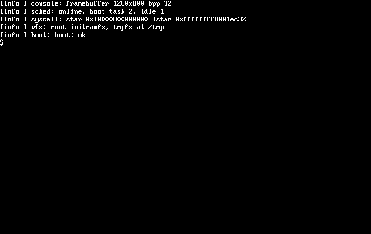
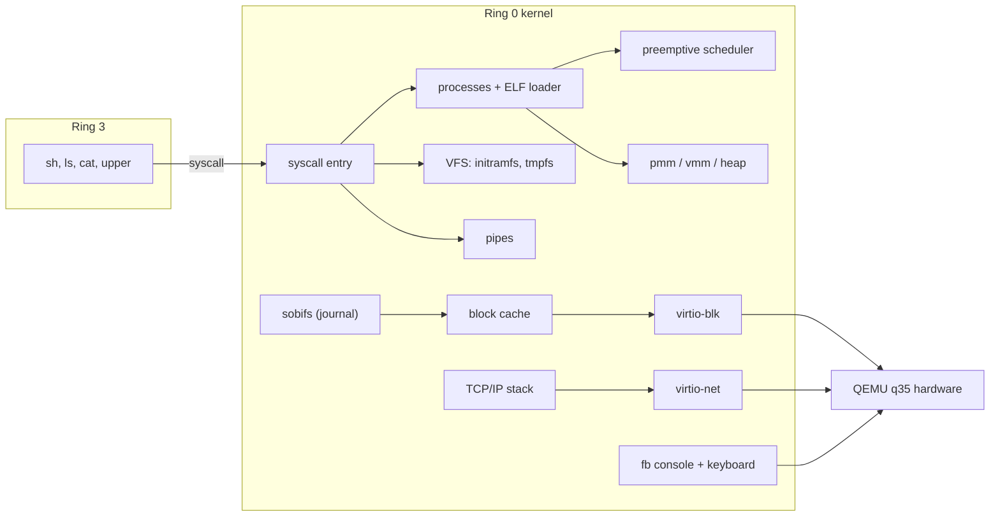

<div align="center">

# SOBI OS

**A 64-bit operating system for x86-64, written from scratch in C and assembly.**

Preemptive multitasking · user mode and system calls · pipes · a journalled filesystem on a virtio disk · a TCP/IP stack on a virtio NIC · framebuffer console and keyboard: all tested in QEMU on every commit.

[](https://github.com/abhijaymishra07/sobi-os/actions/workflows/ci.yml)
[](https://github.com/abhijaymishra07/sobi-os/releases)
[](LICENSE)




*Real recording: boot, then `help`, `ls`, `cat`, `cat | upper`, `uptime`, `hello`, typed on the emulated PS/2 keyboard and drawn by the kernel's own framebuffer console.*

</div>

---

## Highlights

- **From the metal up.** No libc, no borrowed kernel code. The kernel owns its
  GDT/TSS/IDT, page tables, physical and heap allocators, scheduler, drivers
  and filesystems. The only vendored file is the Limine protocol header.
- **Real user space.** Ring-3 processes in isolated address spaces, entered
  with `syscall`/`sysret`, loaded from ELF64 files in an initramfs. A crashing
  program is killed; the kernel keeps running.
- **Concurrency done properly.** Timer-driven preemption, per-task syscall
  stacks and `cr3`, blocking pipes, mutexes and semaphores. `cat | upper` runs
  two processes at once joined by a kernel pipe.
- **Persistent storage.** PCI enumeration, a block layer with a sector cache,
  a virtio-blk driver, and *sobifs*, a journalled filesystem that replays
  committed transactions and detects torn journals. Files survive a reboot.
- **Networking.** Ethernet, ARP, IPv4, ICMP, UDP and TCP (handshake,
  retransmission, teardown) over a virtio-net driver. CI exchanges real UDP
  and TCP traffic with servers on the host.
- **Observability.** A trace ring buffer records context switches, system
  calls and page faults, with a scheduling-latency histogram.
- **Engineered like production code.** 28 automated QEMU scenarios, `-Werror`
  with an extended warning set, ELF layout verification, and CI on every push.
  Every milestone is logged with the commands run and the output observed.

## Quick start

On Ubuntu or Debian:

```sh
sudo apt install build-essential qemu-system-x86 xorriso curl python3
git clone https://github.com/abhijaymishra07/sobi-os.git
cd sobi-os
make run-gui      # opens QEMU with the interactive shell
```

Or skip the build: download the ISO from the
[latest release](https://github.com/abhijaymishra07/sobi-os/releases) and run

```sh
qemu-system-x86_64 -M q35 -m 256M -cdrom sobi-os-v0.11.0.iso -serial stdio
```

Then try:

```text
$ help
$ ls
$ cat
$ cat | upper
$ uptime
```

Other targets: `make test` (full QEMU suite), `make run` (headless, serial on
stdio), `make run-uefi`, `make gdb`, `make help`.

## What's inside

| Area | What SOBI OS implements |
|---|---|
| Boot | Limine protocol (base revision 6), hybrid BIOS/UEFI ISO, higher-half kernel |
| CPU | GDT, TSS with IST stacks for #DF/NMI/#MC, IDT, exception dumps with symbolised RIP, fault fixups |
| Memory | Bitmap frame allocator, 4-level paging with W^X and NX, guard-paged kernel stacks, slab heap with red zones |
| Interrupts and time | xAPIC, I/O APIC, LAPIC timer at 100 Hz calibrated against the PIT |
| Scheduling | Preemptive round-robin, sleep queue, block/wakeup, per-task user context |
| Processes | Per-process address spaces, ELF64 loader, `spawn`, `pipeline`, exit status, fault isolation |
| System calls | 19 calls via `syscall`/`sysret`: process, file, directory, time, memory (`sbrk`), pipes ([reference](docs/system-calls.md)) |
| Filesystems | VFS with fd tables, ustar initramfs at `/`, tmpfs at `/tmp`, journalled sobifs on disk |
| IPC and sync | Blocking pipes, spinlocks, mutexes, semaphores |
| Drivers | 16550 serial, framebuffer console (8x16 font, ANSI clear), PS/2 keyboard, PCI, virtio-blk, virtio-net |
| Networking | Ethernet, ARP cache, IPv4, ICMP echo, UDP sockets, TCP state machine, DNS message parsing |
| User space | crt0 + syscall stubs, `init`, `sh`, `ls`, `cat`, `upper`, `echo`, `hello`, `spin` |
| Debugging | Serial logging with levels, panic reports, GDB target, trace ring buffer and counters |

The exact status of every capability (tested, implemented, partial, planned)
is in [`docs/status.md`](docs/status.md).

## Architecture



A boot walks through Limine, `_start`, then `kmain`, which brings up
serial, CPU tables, memory, the timer, the console, the scheduler, processes,
system calls and the VFS before launching `/bin/init`. The full picture,
including the system-call, context-switch, pipeline, disk and network paths,
is in [`docs/architecture.md`](docs/architecture.md).

## Testing

`make test` builds a test kernel and boots it once per scenario under QEMU.
The kernel selects the scenario from its command line, runs it, and reports
through QEMU's `isa-debug-exit` device; the harness checks both the exit code
and required lines in the serial log.

```text
$ make test
verify-elf: PASS
PASS  boot  panic  unknown-selector  exc  df  pmm  pmm-dbl  pmm-range
PASS  vmm  kheap  kheap-dbl  timer  sched  user  syscall  vfs  elf  multi
PASS  shell  sync  pipe  trace  console  sobifs  net  net-live
PASS  disk-write  disk-read
test: all suites passed
```

Some scenarios worth calling out:

- **`disk-write` / `disk-read`**: two separate QEMU boots share one virtio-blk
  image. The first formats sobifs and writes a file; the second reads it back.
- **`net-live`**: the kernel sends UDP and opens a TCP connection through
  virtio-net to echo servers on the host and checks the replies.
- **`console`**: injects a byte through the i8042 controller so a real IRQ 1
  travels through the I/O APIC to the keyboard handler.
- **`sobifs`**: corrupts the journal on purpose and checks that replay
  detects the tear and the filesystem still mounts.
- **`shell`**: runs a scripted session (`ls`, `cat`, `cat | upper`, `exit`)
  and requires a clean exit status.

Details and the full scenario table: [`docs/testing.md`](docs/testing.md).

## Interesting bugs fixed along the way

Kernel bugs are rarely where they first appear. A few from the
[milestone log](docs/milestones.md):

- **Nested `spawn` corrupted the parent.** Entering user mode from inside a
  system call did not preserve callee-saved registers, so the parent resumed
  with the child's `rbp`. `enter_user` now saves and restores them.
- **The shell died after its child exited.** The return path switched to the
  kernel page tables instead of the parent's, so the parent's next
  instruction fetch faulted. The return path now restores the caller's `cr3`.
- **Two processes could not run at once.** The syscall stack, user return
  pointer, current process and TSS `rsp0` were global. They are now part of
  each task and swapped on every context switch.
- **Keyboard input froze after `clear`.** A slow screen clear with interrupts
  off made the kernel miss an edge-triggered IRQ, and the i8042 never raised
  another. The driver now drains the controller on every poll, and the test
  asserts that the IRQ itself fired.

## Project layout

```text
kernel/arch/x86_64/   entry, GDT/TSS/IDT, exceptions, APIC, syscall and user entry
kernel/mm/            frame allocator, page tables, heap
kernel/sched/         tasks, scheduler, context switch
kernel/proc/          processes, ELF loader, system calls
kernel/fs/            VFS, initramfs, tmpfs, sobifs
kernel/net/           TCP/IP stack, virtio-net
kernel/drivers/       serial, console, keyboard, I/O APIC, PCI, block, virtio-blk
kernel/ipc/ sync/     pipes, locks
kernel/debug/         logging, panic, symbols, trace, test scenarios
user/                 libc stubs, init, shell, commands
tests/                QEMU test scripts and harness
docs/                 architecture, status, milestones, testing, limitations
```

## Documentation

| Document | Contents |
|---|---|
| [Architecture](docs/architecture.md) | Components, boot sequence, key code paths, address space |
| [Status](docs/status.md) | Every capability and its evidence |
| [System calls](docs/system-calls.md) | ABI, registers and every call |
| [Testing](docs/testing.md) | Harness, exit protocol, scenario table |
| [Milestones](docs/milestones.md) | Per-milestone commands, output and fixes |
| [Boot process](docs/boot-process.md), [Interrupts and timer](docs/interrupts-and-timer.md), [Memory rules](docs/memory-rules.md) | Subsystem deep dives |
| [Build](docs/build.md) | Toolchain and flags |
| [Limitations](docs/limitations.md) and [Roadmap](docs/roadmap.md) | What's missing and what's next |

## Roadmap

Next up: mounting sobifs into the VFS at `/disk`, shell redirection and file
utilities, socket system calls, interrupt-driven virtio, and asynchronous
process creation. Further out: `fork` with copy-on-write, multicore, a
security pass (SMEP/SMAP), and benchmarks. See [`docs/roadmap.md`](docs/roadmap.md).

## Built with

- C (gnu11) and GNU assembler, built freestanding with gcc and GNU binutils
- [Limine](https://github.com/limine-bootloader/limine) bootloader (pinned and sha256-verified at build time)
- QEMU (q35, SeaBIOS and OVMF), GDB, xorriso
- References: Intel 64 and IA-32 SDM, the OASIS VirtIO specification,
  the OSDev wiki, RFC 791/793/826

## Contributing

Issues and pull requests are welcome; see [CONTRIBUTING.md](CONTRIBUTING.md).
Every change comes with a QEMU test.

## License

[MIT](LICENSE). `include/limine.h` is 0BSD; see [NOTICE](NOTICE). The console
font is converted from a public-domain Linux console font.
