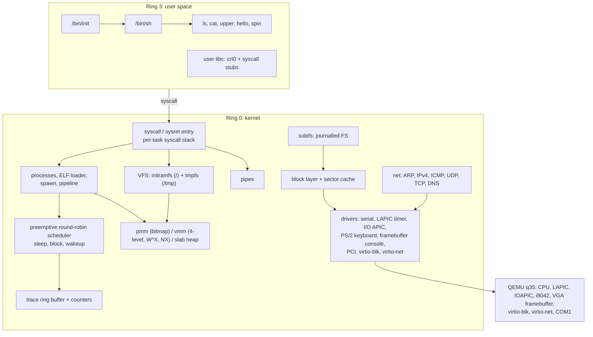

# Architecture

## Overview

SOBI OS is a monolithic x86-64 kernel written in freestanding C (gnu11) with a
small amount of GNU assembler, about 13,000 lines in total. It boots through
the Limine protocol, owns its CPU tables, page tables and allocators,
preemptively schedules kernel tasks and user processes, and provides a VFS,
pipes, a journalled on-disk filesystem, a TCP/IP stack, and a framebuffer and
keyboard console. A small static userland (`init`, a shell and a few commands)
runs in ring 3.



### Boot sequence

```
QEMU (SeaBIOS or OVMF)
  -> Limine 12.9.3: long mode, 4-level paging, HHDM, kernel in the higher half
  -> entry.S  _start: own 16 KiB stack, call kmain
  -> kmain:   serial -> banner -> boot info -> GDT/TSS/IDT -> PMM
              -> copy initramfs -> VMM (own cr3) -> heap -> LAPIC timer
              -> framebuffer console + I/O APIC + keyboard -> scheduler
              -> processes -> syscall MSRs -> VFS -> "boot: ok"
  -> test build: run the selected test scenario and exit QEMU
     normal build: spawn /bin/init, which runs /bin/sh forever
```

### Key paths

- **System call.** `syscall` enters `kernel/arch/x86_64/syscall.S`, which
  switches to the current task's syscall stack (`syscall_stack_top`, swapped
  on every task switch) and calls `syscall_dispatch`. Return is `sysretq`.
- **Entering user mode.** `proc_enter` saves the caller's user context
  (return rsp, syscall stack, current process, `cr3`), builds an `iretq`
  frame in `enter_user`, and resumes the caller when the process exits.
  Callee-saved registers are preserved so `spawn` can nest.
- **Context switch.** `schedule_locked` saves `cr3` and the per-task user
  context of the outgoing task, loads the incoming one, sets TSS `rsp0`,
  switches `cr3` if needed, records a trace event and calls `context_switch`.
- **Pipelines.** `SYS_PIPELINE` allocates a pipe, starts both programs as
  separate tasks with `in_pipe`/`out_pipe` set, and waits; fd 0 and fd 1 are
  redirected to the pipe and each end is closed when its process exits.
- **Disk I/O.** sobifs calls `blk_read`/`blk_write`, which go through a
  64-slot write-through sector cache to the virtio-blk driver. The driver
  builds a three-descriptor chain (header, bounce buffer, status) in a legacy
  virtqueue and polls the used ring.
- **Networking.** Frames for local addresses loop back inside the stack;
  everything else goes to virtio-net. `net_poll` drains the receive ring and
  runs ARP aging and TCP retransmission timers.
- **Keyboard.** IRQ 1 arrives through the I/O APIC at vector `0x31`; the
  handler drains the i8042 and queues ASCII. `read(0)` also polls the
  controller, so a missed edge cannot wedge input.

## Source map

| Path | Responsibility |
|---|---|
| `kernel/arch/x86_64/` | Entry, GDT/TSS, IDT and ISR stubs, exceptions with fault fixups, PIC remap, PIT, LAPIC, `syscall` entry, user entry/exit |
| `kernel/boot/` | Limine requests (memory map, HHDM, modules, framebuffer) and validation |
| `kernel/mm/` | Bitmap frame allocator, kernel page tables and MMIO/stack windows, slab heap |
| `kernel/sched/` | Tasks, run queue, preemption, sleep/block/wakeup, `context_switch` |
| `kernel/proc/` | Processes, address spaces, ELF loader, `spawn`/`pipeline`, syscall table, user-copy helpers |
| `kernel/fs/` | VFS and fd tables, ustar initramfs, tmpfs, sobifs (journalled, replay on mount) |
| `kernel/ipc/` | Blocking pipes |
| `kernel/sync/` | Spinlocks, mutexes, semaphores |
| `kernel/net/` | Ethernet/ARP/IPv4/ICMP/UDP/TCP/DNS, legacy virtio-net |
| `kernel/drivers/` | Serial, framebuffer console and font, I/O APIC, PS/2 keyboard, PCI, block layer, virtio-blk |
| `kernel/debug/` | `kprintf`/`klog`, `panic`, symbol lookup, trace buffer, test scenarios (test build only) |
| `user/` | crt0, syscall stubs, `init`, `sh`, commands |
| `tests/` | One script per area; `tests/lib/run_qemu_test.sh` boots QEMU and checks exit status and serial output |
| `scripts/` | Limine fetch, ISO creation, symbol table, ELF checks, font and demo generation |

## Address space at entry

Limine hands over with 4-level paging enabled and these mappings (base
revision 6):

- The kernel image at `0xffffffff80000000` (virtual), text R+X, rodata R, data
  RW, loaded physically wherever the bootloader chose (observed `0xff7a000` under
  SeaBIOS, `0xe299000` under OVMF). The physical base comes from the
  Executable Address response and is never assumed.
- A Higher Half Direct Map (HHDM) at the offset reported by the HHDM response
  (observed `0xffff800000000000`). Only Usable, Bootloader-reclaimable,
  Executable+Modules, Framebuffer, ACPI, and Reserved-mapped regions are in the
  HHDM. MMIO such as the local APIC is not.
- Limine's own GDT, page tables, stack, and response structures live in
  Bootloader-reclaimable memory and remain in use until the kernel replaces
  them (see `memory-rules.md`).

Kernel linker layout (`linker.ld`): three `PT_LOAD` program headers, each
page aligned, in the order text, rodata (+ `.eh_frame`), data (+ Limine
request sections + `.bss`). Linker symbols `__text_start/_end`,
`__rodata_start/_end`, `__data_start/_end`, `__bss_start/_end`,
`__kernel_start/_end` delimit them and are printed at boot.

## Build configurations

| `BUILD=` | Flags | Purpose |
|---|---|---|
| `debug` (default) | `-O0 -g3` | Development and GDB. |
| `release` | `-O2 -g` | Optimised; symbols kept for post-mortem. |
| `test` | debug flags + `-DSOBI_TEST=1` | Adds `kernel/debug/test.c` and the QEMU exit-port writes. Used by `make test`. |

All configurations share the freestanding flag set described in `build.md`.

## Conventions

- Comments are rare and only state constraints the code cannot show; design
  rationale lives in `docs/`.
- `-Werror` with an extended warning set; the linker runs with
  `--fatal-warnings`.
- Nothing in the kernel trusts a bootloader value without checking for its
  presence; missing responses are fatal with a specific panic message.
- Milestone evidence (commands, output, exit codes) is appended to
  `milestones.md` before the milestone is committed.
